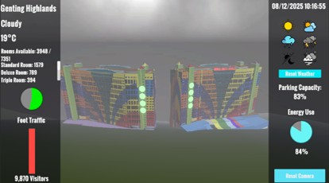

# First World Hotel Digital Twin Prototype

An internship project that demonstrates a Unity-based 3D Digital Twin prototype for exploring hotel room layouts and visualising selected operational and environmental data.

> **Repository scope:** This is a documentation/portfolio repository. The Unity project files, source code, 3D assets, and executable build are not included, so this repository cannot be used to run or rebuild the prototype.

## Project Overview

The prototype combines an interactive 3D hotel environment with a data pipeline that sends updates to a Unity user interface. It was developed as a proof of concept for improving room exploration and presenting hotel information in a spatial, interactive interface.

## Features

- **Interactive 3D hotel model:** Rotate the model and reset the camera view.
- **Operational data dashboard:** Display metrics such as foot traffic, parking capacity, energy use, and room availability. These operational metrics are simulated in the prototype.
- **Environmental information:** Retrieve weather conditions and temperature from the Open-Meteo API.
- **Room selection:** Explore eight room categories: Standard Room, Deluxe Room, Triple Room, World Club Room, World Club Room 2, Superior Deluxe Room, Y5 Deluxe Room, and Y5 Triple Room.
- **Interactive room layouts:** Navigate room interiors using keyboard and mouse controls.
- **First-Person View (FPV):** Enter a room from its entrance and explore the interior.
- **Day/night mode:** Switch the lighting environment between day and night.
- **Room interactions:** Raise the ceiling to view the interior and open room doors.

## Technology Stack

| Technology / Tool | Role in the prototype |
|---|---|
| Unity 3D (2022.3.62f3) | 3D environment, camera controls, interactions, and user interface |
| C# | Unity-side interaction, UI updates, and MQTT subscription logic |
| Python | Generates simulated operational metrics and publishes data messages |
| MQTT | Messaging protocol between the data publisher and Unity client |
| Mosquitto | Local MQTT broker |
| Open-Meteo API | Provides weather and temperature data |
| Visual Studio 2022 | C# development and debugging |
| Visual Studio Code | Python development |

## High-Level Architecture

1. A Python publisher generates simulated operational data and obtains environmental data from Open-Meteo.
2. The publisher sends data as JSON messages through a local Mosquitto MQTT broker.
3. A C# MQTT subscriber in Unity receives the messages and updates the interface.
4. The Unity scene presents the data alongside the interactive 3D hotel environment.

```text
Python Data Publisher ── MQTT / JSON ──> Local Mosquitto Broker
          │                                      │
          └── Open-Meteo API                      ▼
                                      Unity C# MQTT Subscriber
                                                 │
                                                 ▼
                                    3D Environment and UI
```

## Prototype Scope and Limitations

- Operational metrics such as foot traffic, parking capacity, and energy use are simulated rather than supplied by live hotel sensors.
- The prototype uses a local MQTT broker; it is not presented as a production deployment.
- The Standard Room is identified in the report as a reference-scale model. Other room layouts are conceptual and should not be treated as verified representations of actual hotel specifications.
- The Unity source project, assets, and build are not included in this repository.

## Project Report

The accompanying report describes the project background, tools and technologies, backend architecture, interface features, schedule, limitations, and future improvement recommendations.

Place the report in the `docs/` folder with this filename so the link works:

- **[Project Report](Document/First%20World%20Hotel%20Digital%20Twin%20Report.docx)**

## Screenshots

Screenshots can be added here if they are approved for public sharing. Place them in a `screenshots/` folder and link them with Markdown, for example:

```md

.jpg)
.jpg)
.jpg)
.jpg)
```

## Notes on Availability

This repository documents the prototype but does not contain the full implementation. The source project and third-party assets have been omitted from this public-facing portfolio repository. Publish this repository and the report only if your internship organisation permits public sharing; check permission and applicable licences for the hotel model, screenshots, and other third-party materials.

## Acknowledgements

- Open-Meteo for the environmental data API.
- The source/model asset providers, where applicable and subject to their licence terms.
